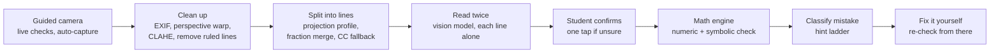

# Where Did I Go Wrong?

**Answer apps show you the answer. We show you where you went wrong, so you stop making the same mistake.**

A phone-first web app that photographs a student's handwritten math and circles the exact line where the first mistake happened. It doesn't solve the problem. It finds the error, explains it with a hint ladder, and lets the student fix it themselves.

**Core principle: the AI reads the work, a math engine judges it.** A vision model only transcribes handwriting. SymPy proves whether each step is valid, so the app can't hallucinate a verdict. When it isn't sure, it asks instead of guessing.

Built for Banana Hacks 2026 (theme: Image AI).

**New to this?** [GETTING_STARTED.md](GETTING_STARTED.md) walks through installing, running, putting it online and turning it into a phone app, step by step. The product website is in [`website/`](website/).



## Features

All features from the product spec are implemented:

| Feature | What it does | Free | Plus |
|---|---|---|---|
| Guided camera | Live coaching (light, glare, framing, centering, motion, blur, no writing) and auto-capture, with torch toggle and upload fallback | ✓ | ✓ |
| Error locator | Red circle on the first broken step, on the original photo | 5 checks/day | Unlimited |
| Hint ladder | Where → what kind → the fix, using the student's own numbers | Hint 1 | All 3 |
| Fix it yourself | Rewrite the step by typing, photo or stylus; later lines are re-checked | ✓ | ✓ |
| Algebra | Linear/quadratic equations, simplifying, factoring, inequalities, systems, exponentials | ✓ | ✓ |
| Advanced math | Derivatives, integrals (checked by differentiating), limits | – | ✓ |
| Mistake profile | Patterns by type and topic ("62% of your mistakes are sign errors") | 7 days | Full |
| Targeted practice | Problems aimed at your weakest mistake, answers verified by the engine, spaced repetition | – | ✓ |
| Whole-page mode | Snap a page with several problems, get a report for each | – | ✓ |
| Test prep | Top 3 mistake types in a unit plus a 10-minute drill | – | ✓ |
| History | Every checked problem, searchable by topic | 7 days | Full |
| Parent & tutor sharing | Revocable link showing patterns and progress, never photos or answers; family view for several students | – | ✓ |
| Concept mini-lessons | "Why does this rule work?" with a worked example verified by the engine | ✓ | ✓ |
| Streaks & progress | Day streaks, "N problems with no sign errors in a row", self-fixed mistakes, shareable win cards | ✓ | ✓ |

Also: trust tiers on every verdict, a whole-problem sanity check, a final answer shown only if the student explicitly asks, optional accounts (13+, cross-device sync), opt-in transcription corrections, data export and deletion, dark mode, and an installable app (PWA with offline support; Capacitor config for the app stores).

**Payments aren't connected.** The Plans page switches plans instantly with a clear "early access, no card needed" note. Pricing is an open question in the spec.

## Quick start

Requires Python 3.11+ (tested on 3.13) and Node 20+ (tested on 22).

**One command:** `./start.sh` (Mac/Linux) or double-click `start.bat` (Windows). It installs everything on the first run and starts both servers. Or step by step:

```bash
# Backend
cd backend
python -m venv .venv
.venv/bin/pip install -r requirements-dev.txt
cp .env.example .env            # add one API key for handwriting transcription (optional)
.venv/bin/uvicorn app.main:app --reload --port 8000

# Frontend (another terminal)
cd frontend
npm install
npm run dev                     # http://localhost:5173 (proxies /api to :8000)
```

Without an API key everything works except reading handwriting from your own photos. The app still finds the lines in your photo, shows each crop, and asks you to type what it says. The bundled sample photos work fully, and typing your work works everywhere.

**On a phone:** `npm run dev` listens on your network. The upload button works over plain HTTP. The live camera needs HTTPS, so use the deployed URL or a tunnel such as ngrok.

### Configuration (`backend/.env`)

| Variable | Default | Meaning |
|---|---|---|
| `ANTHROPIC_API_KEY` / `GEMINI_API_KEY` / `OPENAI_API_KEY` | – | Set one to enable transcription; the provider is picked automatically |
| `TRANSCRIBE_PROVIDER` | `auto` | `anthropic`, `gemini`, `openai` or `auto` |
| `READ_MODELS` | provider defaults | The two reads of each line, e.g. `anthropic:claude-haiku-5-5,gemini:gemini-2.5-flash` (two different models is best) |
| `TIEBREAK_MODEL` | provider default | Stronger model, called only when the two reads disagree (`none` to disable) |
| `AI_HINTS` | `1` | AI-phrased hints 2 and 3 (every equation verified by the engine; falls back to templates) |
| `CORS_ORIGINS` | `*` | Comma-separated origins allowed to call the API |
| `ENGINE_WORKERS` | min(4, CPUs) | Worker processes for SymPy/OpenCV |
| `DATA_DIR` | `backend/data` | SQLite database (accounts, share links, opt-in corrections) |

Default models, following the spec ("cheap model for the two reads, a stronger one only on disagreement"): Anthropic `claude-haiku-5-5` + `claude-sonnet-5-5`, tiebreak `claude-opus-5-5`. Gemini and OpenAI defaults live in `backend/app/transcribe/providers.py`; model names change often, so override them with the variables above. Anthropic's commercial API doesn't train on submitted data by default.

## Deploying

**Option A: one container.** The root `Dockerfile` builds the frontend and serves it from the API on one origin:

```bash
docker build -t wdigw . && docker run -p 8000:8000 -e ANTHROPIC_API_KEY=... wdigw
```

**Option B: Vercel + Render** (the spec's free hosting). `render.yaml` deploys `backend/`; set `ANTHROPIC_API_KEY` and `CORS_ORIGINS=https://your-app.vercel.app`. Deploy `frontend/` to Vercel with the environment variable `VITE_API_URL=https://your-api.onrender.com`; `vercel.json` handles client-side routes. On Render's free tier the disk is temporary, so accounts and share links reset when the service restarts. Attach a disk (and point `DATA_DIR` at it) to keep them.

## Install as an app

- **From the browser (PWA):** on any HTTPS deployment, iPhone users tap Share → Add to Home Screen; Chrome and Edge offer Install. The service worker (`frontend/public/sw.js`) caches the app shell so it opens offline, and never caches `/api`. In-app steps are under More → Install the app.
- **App Store and Google Play:** `frontend/capacitor.config.json` is ready. Build with `VITE_API_URL` (your API) and `VITE_PUBLIC_URL` (your website, for share links), run `npx cap add ios|android` and `npx cap sync`, then add the camera permission and `capacitor://localhost,https://localhost` to `CORS_ORIGINS`. Full steps in [GETTING_STARTED.md](GETTING_STARTED.md#8-make-it-an-app).

## Website

`website/index.html` is a static product page using real app screenshots (`website/img/`). Set `APP_URL` near the bottom of the file to your deployed app, then host the folder anywhere static (Netlify Drop, Vercel, GitHub Pages).

## How it works

### Computer vision (`backend/app/vision/pipeline.py`)
1. **Clean up:** EXIF rotation (Pillow), then the largest four-sided contour is warped flat (the warp matrix is kept, and its inverse maps every box back onto the original photo). Lighting is evened out with CLAHE and an adaptive threshold. Notebook and grid lines are removed with long morphological openings, measured against the page width, including dashed fragments.
2. **Split into lines:** a smoothed horizontal projection profile finds the lines. Thin spans (fraction bars, exponents) merge into their neighbors, touching lines split at deep valleys, and blobs and slivers are dropped. Very tall spans fall back to clustering connected components by vertical center.
3. Each line becomes a padded crop: up to 800 px for the model, plus a thumbnail for the confirm screen.

### Transcription (`backend/app/transcribe/`)
Each crop goes to a vision model **alone**, with a "transcribe exactly, even if it's wrong" prompt and no problem context. These are the three defenses against the autocorrect trap. Every line is read twice, in parallel, and the two readings are compared **mathematically** with SymPy (`x*2` and `2x` agree). A stronger model is called only on disagreement. Lookalike letters (s/5, z/2, l/1…) that don't fit the rest of the problem are flagged. Providers: Anthropic, Gemini and OpenAI.

### Math engine (`backend/app/engine/`)
- **Parsing:** `parse_expr` with implicit multiplication and `^`, plus handwriting conventions: `f'(x)`, `dy/dx`, `d/dx(…)`, `∫ … dx`, `lim_(x→a)`, `x = ±3`, `x = 2 or x = -3`, systems separated by `;`, and leading `=`. Input is reduced to a whitelist and evaluated without builtins, and number towers like `9^9^9` are rejected before evaluation.
- **Valid steps:** each line is compared only to the line before it.
  - Expressions must be identically equal.
  - Equations and inequalities must keep the same real solution set.
  - Derivatives are compared with `diff`.
  - Antiderivatives are compared by differentiating.
  - System steps must follow from the original system.
- **Two checks together:** a random exact-fraction test (exact for rational results, 30-digit evaluation otherwise, skipping points outside the domain) plus a symbolic proof, each under a 2-second limit enforced in worker processes.
- **Trust tiers:** *verified* (proved exactly), *checked numerically* (random tests passed, proof timed out), *uncertain* (couldn't read or decide).
- **Policies:**
  - Only the first break is flagged; later consistent lines are "consistent with your earlier step".
  - Dividing by or squaring a variable is a yellow warning, not an error.
  - A step that is true only for positive values is a warning.
  - A missing `+ C` gets a gentle note.
  - Rounded decimal answers are accepted.
  - The whole-problem sanity check marks lines uncertain when the final answer is right but a step failed (usually a misread line), until the student confirms the reading.
- **Error classifiers** (deterministic, in order): inequality flip, one side only, sign error (moved term or flipped term, including distributing a negative), distribution, exponent rules, arithmetic slip (with "double-check 7 − 3"), derivative rules (chain, product, quotient, power, trig sign), antiderivatives (sign, coefficient), and lost or extra solutions.
- **Hints:** templates built from those facts. When AI hints are on, a model rewords hints 2 and 3, every equation in its text is checked with SymPy, and after two failures the templates are used.

### Frontend (`frontend/`)
React 19 + Vite + Tailwind 4 + KaTeX, mobile-first, with a light and dark theme.
- Camera checks run in the browser on a 320 px frame, about 6 times a second, using plain JavaScript pixel math (`src/lib/analyzer.ts`). A message only changes after 3 frames in a row; capture happens after 6 good frames in a row.
- Profile, history and spaced repetition live in local storage until the student creates an account. Saved photos live only in IndexedDB.

## Testing and results

```bash
cd backend && .venv/bin/python -m pytest                 # 206 tests: engine, vision, transcription, API
cd backend && .venv/bin/python -m eval.engine_stress 300 # randomized false-alarm / localization test
cd backend && .venv/bin/python -m eval.run_eval --samples --synthetic 28   # full-pipeline metrics
cd frontend && npm test                                  # unit tests (camera analyzer, state, profile)
cd frontend && npx playwright test                       # end-to-end, incl. fake-webcam auto-capture
```

Measured in this repository:

| Metric | Result |
|---|---|
| False alarms on random correct solutions (`engine_stress`) | **0 of 300** |
| Planted errors circled on the right line (`engine_stress`) | **297 of 300**; the other 3 changes left the step mathematically valid |
| Photos split into the right lines (randomized size, tilt, light, blur) | **80 of 80** unseen variants |
| Error localization on the sample test set (`run_eval`) | **20 of 20**, **0 false alarms**, 0 uncertain |
| Engine unit tests (valid pairs that must never be flagged, planted errors by type) | all passing |

Honest caveats:
- The sample photos are generated: handwriting fonts on ruled paper, photographed onto a desk with tilt, uneven light, blur and noise. Accuracy on real handwriting depends on the vision model and should be measured with `eval/run_eval.py --cases your-photos/` (format in the script's docstring).
- The transcription providers are tested against local mock servers that use each SDK's real request and response format. No live API key was available while building, so set one and run the eval to confirm end to end.
- The camera thresholds are starting points from the spec. Turn on *Account & settings → Show camera metrics* and tune them on a real phone in good light, dim light and under a desk lamp.

## Privacy and safety

- Photos are processed in memory and discarded. Results are cached in memory for an hour, keyed by image hash, so retakes are instant; the photo itself isn't cached.
- No sign-up is needed. Accounts are optional and for ages 13 and up; the date of birth is checked once and not stored.
- Share links show patterns, never photos or answers, and can be revoked.
- Transcription corrections are sent only with opt-in permission, and as text only.

See the in-app Privacy page for details.

## Project structure

```
backend/
  app/
    engine/        parsing, equivalence, classifiers, hints, checker, practice, lessons
    vision/        photo cleanup and line splitting (OpenCV)
    transcribe/    providers (Anthropic, Gemini, OpenAI), read-twice reconciliation
    samples/       sample photos + true transcriptions
    main.py        FastAPI app (/api/read, /api/check, /api/fix, ...; docs at /api/docs)
  eval/            randomized engine stress test and full-pipeline evaluation
  scripts/         sample photo generator (OFL handwriting fonts)
  tests/
frontend/
  src/pages/       every screen
  src/lib/         API client, local state, camera analyzer, profile stats
  e2e/             Playwright tests
  public/          manifest, service worker, app icons
website/           static product page + screenshots
start.sh / start.bat   one-command install and run
GETTING_STARTED.md     beginner setup, deploy and app-store guide
```

## Roadmap

- **More math:** matrices and row reduction, eigenvectors, differential equations.
- **AI-review tier:** proofs and word problems, clearly labeled as unverified.
- **Schools:** a teacher dashboard with a heatmap of which step a class misses.
- **Check as you write:** prop the phone over the page and each new line is checked as it's finished.
